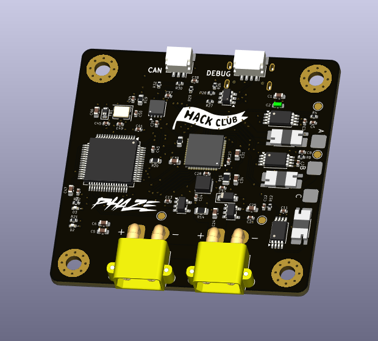
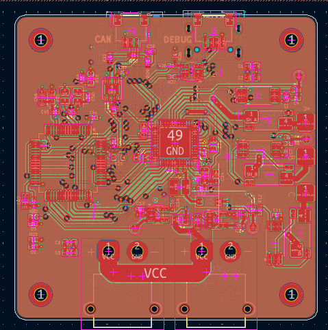

# Phaze
A field-oriented control board designed to be used with a brushless motor.



## Overview
Phaze is my attempt at making a custom FOC driver. It utilizes the CAN protocol for communication between a main board and the driver, but it can also be programmed directly via an STLink-V2 debugger. 


See [SCHEMATICS](KiCAD/Phaze.pdf)

## Extra Info
1. **Use a 4s LiPo battery** if you decide to use this board in your project. **Discard the battery if it smells "funny".**

2. **Check for any damage on the pcb** as it can be the reason for a **catastrophic failure**.

## Firmware Flashing Instructions

### 1. Clone the repository

```bash
git clone git@github.com:GoTouchGra55/Phaze.git
```

### 2. Open the project in a code editor

Navigate into the firmware directory. For VS Code users:

```bash
cd Phaze
code .
```

### 3. Edit the code

You have all the freedom to implement your own new features. Infact, I encourage you to do so.

Just be sure to add your drivers to the `CMakeLists.txt` file or you'll be stuck with a nasty build error and wonder why your code won't work.

### 4. Build the firmware

```bash
cmake --preset Debug
cmake --build --preset Debug
```

### 5. Connect the ST-Link debugger

Connect the pins according to the silkscreen and the debugger labels.

Note: You can skip the 3.3V if your board is powered by an external power source.

### 6. Flash the firmware

With the ST-Link connected, press the Debug button in VS Code.

Cortex-Debug will launch the debugger and program the generated .elf file into the STM32's internal flash.

Once the firmware has been flashed, you can stop the debugging session.

### 7. Disconnect the ST-Link

You can now disconnect the ST-Link from the CASSINI board before testing standalone operation.

The ST-Link is connected to the STM32's debug and reset circuitry. Leaving it connected can affect the NRST line and prevent the board from operating correctly when powered independently.

I faced this error during the final phases of development and thought that it was a hardware error from my part, but really, it's the debugger. So, always remove before testing standalone operation.

### 8. Power the board

Disconnect USB and power Phaze from a suitable power source.

The STM32 should now boot directly from its internal flash and execute the newly flashed firmware.

## Bill Of Materials
| # | Component / Item | Specifications | Qty. | Price (USD) |
|---:|---|---|---:|---:|
| 3 | SMD Resistor Assortment | 660 pcs, mixed packages and values | 1  | $0 |
| 5 | SMD Ceramic Capacitor Assortment | 2,500 pcs, 50 values, mixed packages | 1  | $0$ |
| 9 | JLCPCB PCB Fabrication & Assembly | PCB manufacturing and assembly order | 1 order | $241.02 |
| | **GRAND TOTAL** | | | **$241.02** |

## License
### MIT License - See [LICENSE](LICENSE)

## Author
### Shaurya Tamang  
Contact: [Email](shauryatamang.dev@gmail.com)