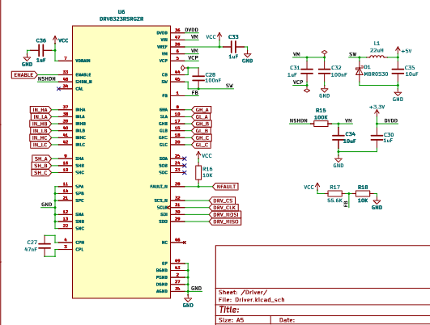

# Phaze
A field-oriented control board designed to be used with a brushless motor.

## Overview
Phaze is my attempt at making a custom FOC driver. It utilizes the CAN protocol for communication between a main board and the driver, but it can also be programmed directly via an STLink-V2 debugger. 

The main goal of this project was to explore the hardware side of field-oriented control, especially the design of a dedicated motor driver and the electronics required to control a bldc motor. I wanted to design my own board and understand how all the different sections work together, rather than relying on any existing motor controllers.

## Design
 
    
SEE [SCHEMATICS](KiCAD/Phaze.pdf)

## Build Instructions
1. Order the PCB using the provided [files](KiCAD/production).
2. Solder all SMD components according to the schematic and PCB layout.
3. Inspect all solder joints and check for shorts.
4. Connect the peripherals according to the schematic.
5. Flash the firmware and verify all interfaces.
6. Test the power rails before connecting the motors.

## IMPORTANT
1. Use a 3-4s LiPo battery if you decide to use this board in your project. Discard the battery if it smells "funny".

2. Check for any damage on the pcb as it can be the reason for a catastrophic failure.

## Bill Of Materials
| # | Component / Item | Specifications | Qty. | Price (USD) | Link |
|---:|---|---|---:|---:|---:|
| 1 | SMD Resistor Assortment | 660 pcs, mixed packages and values | 1  | $0 | [Daraz](https://www.daraz.com.np/products/000000pcs-040222-10hm-910k-ohm-5-80llasex-cp0pcs-u003d-4000pcs-i416649373-s1793309546.html?c=&channelLpJumpArgs=&clickTrackInfo=query%253Asmd%252Bresistors%253Bnid%253A416649373%253Bsrc%253ALazadaMainSrp%253Brn%253Aa5197133a3019ce49e53177277acb4a7%253Bregion%253Anp%253Bsku%253A416649373_NP%253Bprice%253A1305%253Bclient%253Adesktop%253Bsupplier_id%253A900273856834%253Bsession_id%253A%253Bbiz_source%253Ahttps%253A%252F%252Fwww.daraz.com.np%252F%253Bslot%253A5%253Butlog_bucket_id%253A470687%253Basc_category_id%253A10000489%253Bitem_id%253A416649373%253Bsku_id%253A1793309546%253Bshop_id%253A191864%253BtemplateInfo%253A&freeshipping=0&fs_ab=1&fuse_fs=&lang=en&location=Overseas&price=1305&priceCompare=skuId%3A1793309546%3Bsource%3Alazada-search-voucher%3Bsn%3Aa5197133a3019ce49e53177277acb4a7%3BoriginPrice%3A130500%3BdisplayPrice%3A130500%3BisGray%3Afalse%3BsinglePromotionId%3A-1%3BsingleToolCode%3AmockedSalePrice%3BvoucherPricePlugin%3A0%3Btimestamp%3A1794537582362&ratingscore=&request_id=a5197133a3019ce49e53177277acb4a7&review=&sale=3&search=1&source=search&spm=a2a0e.searchlist.list.5&stock=1) |
| 2 | SMD Ceramic Capacitor Assortment | 2,500 pcs, 50 values, mixed packages | 1  | $0 | [Daraz](https://www.daraz.com.np/products/2500pcs-50-values-capacitor-smd-0402-0603-0805-smd-ceramic-capacitors-assortment-kit-1p-10uf-1pf-5pf-10pf-100pf-1nf-102-333-474-i1514281975-s12310158935.html?c=&channelLpJumpArgs=&clickTrackInfo=query%253Asmd%252Bcapacitor%252B0402%253Bnid%253A1514281975%253Bsrc%253ALazadaMainSrp%253Brn%253Abb4c895be7dbb09066bdbc9410dfb62b%253Bregion%253Anp%253Bsku%253A1514281975_NP%253Bprice%253A1356%253Bclient%253Adesktop%253Bsupplier_id%253A900279168309%253Bsession_id%253A%253Bbiz_source%253Ah5_external%253Bslot%253A0%253Butlog_bucket_id%253A470687%253Basc_category_id%253A10001489%253Bitem_id%253A1514281975%253Bsku_id%253A12310158935%253Bshop_id%253A198893%253BtemplateInfo%253A&configId=choice_NP_promotion&freeshipping=0&fs_ab=1&fuse_fs=&lang=en&location=Overseas&price=1356&priceCompare=skuId%3A12310158935%3Bsource%3Alazada-search-voucher%3Bsn%3Abb4c895be7dbb09066bdbc9410dfb62b%3BoriginPrice%3A135600%3BdisplayPrice%3A135600%3BisGray%3Afalse%3BsinglePromotionId%3A-1%3BsingleToolCode%3AmockedSalePrice%3BvoucherPricePlugin%3A0%3Btimestamp%3A1794537638805&ratingscore=&request_id=bb4c895be7dbb09066bdbc9410dfb62b&review=&sale=0&search=1&source=search&spm=a211g0.searchlist.list.0&stock=1&upItemIds=1514281975) |
| 3 | JLCPCB PCB Fabrication & Assembly | PCB manufacturing and assembly order | 1 order | $241.02 | [JLCPCB](https://jlcpcb.com)
| | **GRAND TOTAL** | | | **$241.02** | |

## License
### MIT License - See [LICENSE](LICENSE)

## Author
### Shaurya Tamang  
Contact: [Email](shauryatamang.dev@gmail.com)